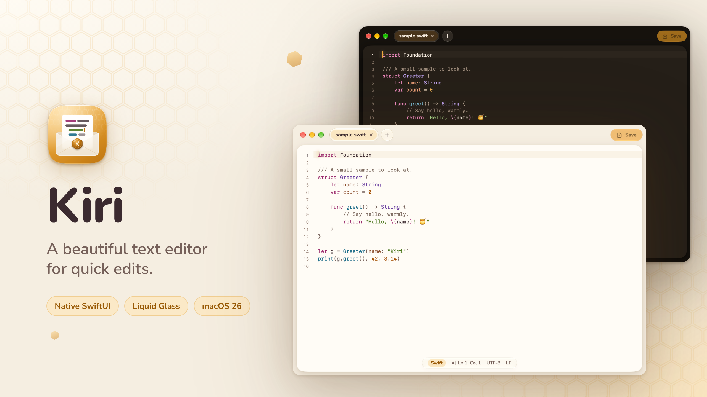

# Kiri

[](https://github.com/ErikHellman/kiri/releases/latest)
[](https://github.com/ErikHellman/kiri/actions/workflows/ci.yml)
[](https://github.com/ErikHellman/kiri/releases)

[](#license)

A beautiful text editor for quick edits. **[kiri.hellsoft.se](https://kiri.hellsoft.se)** · **[Download for Mac](https://github.com/ErikHellman/kiri/releases/latest)**

[](https://kiri.hellsoft.se)

Kiri is a native SwiftUI app for macOS that launches instantly, opens the files you reach for every day, and highlights the syntax of common programming languages. It is built for opening a file, making a change and getting back to work, not for replacing a full IDE.

## Features

- **Instant launch** into an empty editor (about 0.3 s to the first window on an M-series Mac, measured with `-KiriLaunchTiming YES`).
- **Honey + Liquid Glass design**: glass chrome (tab strip, Save, status bar, find bar, command palette) over a warm canvas, the text on a solid panel. Light, dark and high-contrast; follows Reduce Motion and Reduce Transparency. Six color themes (Settings ▸ Theme, View ▸ Theme); in Settings each swatch shows its theme's accent, canvas, paper and syntax colors, light above the diagonal and dark below, and pointing at one shows that theme in every window until the pointer moves away (a click keeps it). Changing the theme or light and dark crossfades every window over a quarter of a second, or changes at once with reduced motion.
- **Any text file**: plain text, Markdown, JSON, YAML, TOML, XML, CSV, logs, source code. Kiri detects the encoding (UTF-8, UTF-16/32 with or without BOM, Windows Latin 1) and line endings (LF, CRLF, CR) and saves them back unchanged; change either from the status bar.
- **Saving is yours**: the file changes when you save (⌘S, the Save button, File ▸ Save As…) and at no other time. The Save button is a small glass circle while there is nothing to save and opens into the amber Save pill when the document has unsaved changes, as the tab's dot does. Closing a tab or quitting with unsaved changes asks first. What you haven't saved is kept for a crash: five seconds after an edit Kiri writes a recovery copy (in `~/Library/Autosave Information`, never beside your file), and the next launch brings the document back with its changes, still unsaved; saving, reverting or closing deletes the copy. File ▸ Revert to Saved goes back to the file. A file changed by something else (git, a formatter) is taken up when the document has no unsaved changes; otherwise Save asks before writing over it.
- **Large files and live logs**: a file of 50 MB or more (a log of many GB too) opens read-only, after asking, in a viewer of its own that reads only the lines on screen, so it opens at once and scrolls smoothly whatever its size. The status bar shows its size while the lines are counted in the background. Find searches the whole file on every core, with match case and regular expressions, and the find bar's **Only matching lines** shows just the lines with a match, as `grep` would; Go to Line, selecting and copying work as in the editor. A file that grows (a log being written) is followed, and a view at the end stays at the end, as `tail -f` does; a file that is truncated or rotated starts over. Output piped into `kiri -` that goes on (`adb logcat | kiri -`) opens in the same viewer and is followed live.
- **Pictures, videos and archives**, read-only, in the editor's place. Pictures (JPEG, PNG, GIF, WebP, HEIC, TIFF, AVIF, BMP and whatever else macOS reads) open at their own size, or smaller to fit, and zoom with a pinch, ⌘+ and ⌘− (⌘0 for the actual size, a double-click to fit again); animated GIF, PNG and WebP play. Videos and sounds (MPEG-4, QuickTime, MPEG and whatever else macOS plays) play in the system's player. A zip (also `.jar`, `.apk` and the like), tar or tar.gz shows what it holds as a tree, with each file's size unpacked and each folder's total, without unpacking anything. An SVG opens on its picture, with a Text / Preview switch (⌃⌘P) to edit it as XML. What a file is comes from its first bytes, not its name. The video player is a framework of its own that loads only when a video opens, so launch stays as quick as before. Other binary files are not opened.
- **Syntax highlighting** with Tree-sitter for Swift, JSON, YAML, Markdown, JavaScript, TypeScript/TSX, Python, shell, HTML, CSS, Go, Rust, Java, Kotlin, C#, C, C++ and Zig, and a lightweight lexer for TOML, INI, XML, Objective-C and more. Only the visible text is colored, so large files stay fast.
- **Tabs**: documents open as tabs in one window, under a Honey tab strip with dirty dots. The tabs are Kiri's own, not the system's window tabs: opening a file never makes a window, so window managers (AeroSpace, yabai, Rectangle) have nothing to move or retile, and the file's text fades in where the window is. Each tab keeps its own selection, scroll position and find bar. Pull a tab out of the strip to give it a window of its own, or onto another window's strip to move it there; Window ▸ Move Tab to New Window and Merge All Windows do the same from the menu. A window comes back at the next launch with all its tabs. A file you open again, also after a relaunch, is back where you left it: the same selection and the same line at the top (Kiri keeps that for the 500 files used last, under a hash of each file's path). The selected tab shows its whole name and the others shorten in the middle ("Greet….swift"); with more tabs than fit, the strip scrolls and a menu at its end lists them all. A tab's tooltip is its file's path, and files with the same name show their folder ("index.ts · api").
- **Side by side**: a window shows two of its tabs next to each other, each on its own panel, under its one tab strip. View ▸ Split Editor (⌘\\) puts the tab you had before beside this one, and ⌘\\ again goes back to one; with a single tab it opens Go to File to pick one. Open to the Side with ⌥-click on a sidebar file or a tab, ⌥↩ in the sidebar or the palette, the first item of a sidebar file's or a tab's context menu, or by dragging a tab, or a file from Finder, onto the left or right of the editors (a file dropped in the middle still just opens as a tab). The side with the keyboard has a thin accent edge, and the top bar, the title and the menus follow it; click the other side, its tab, or press ⌥⌘← / ⌥⌘→ to move there. ⌘W, ⌘1–9 and ⌃⇥ act on the keyboard's side and pass over the tab beside it. Drag the gap between the two to give one more room (a double-click makes them half and half); View ▸ Swap Sides and Window ▸ Move Tab to Other Side rearrange them. View ▸ Preview to the Side (⌥⌃⌘P) shows a Markdown or SVG file's text with its preview beside it, following what you type. A window too narrow for two grows to fit, and a split window comes back split at the next launch.
- **Folder sidebar** (`kiri <folder>` or File ▸ Open Folder…): the folder's files beside the editor. A click on a file (or Space) shows it in the window's one preview tab, its title slanted, and the next file you click takes that tab over, so looking through a folder leaves one tab and not one for each file (and nothing in Open Recent: a file is a recent document once it is kept). Editing the file, saving it, a double-click on its row or on its tab, or Return on its row keeps the tab. A file that is already open is just selected. A folder opened with a file has the keyboard in the editor; a folder opened alone has it in the sidebar, so the arrows and Space look through the files at once. Each file has an icon for its kind (code, markup, data, settings, a script, a table, prose) in its language's syntax color, so a folder can be scanned by color; folders are amber. Rows say what is open: the name of a file that is open in one of the window's tabs is bold (slanted while it is the preview), and one with unsaved changes has the tabs' amber dot. A right-click (or Control-click) on a row has Open in New Window, Reveal in Finder, Copy Path, Copy Relative Path and, on a file, Rename…; on a folder and on the empty area there is New File…, which makes an empty file there and opens it. Names are typed in place: Return gives the name, Escape gives it up, and a name that is taken is refused. With the keyboard in the sidebar, ⌘F finds a file or folder by a few letters of its name anywhere under the folder, inside closed folders too (the folders above it open): typing goes to the first match, ⌘G and ⇧⌘G (or ↓ and ↑) to the next and previous, going round at the ends, Return leaves the keyboard on it and Escape goes back to where you were. The sidebar's query is its own, kept for the next ⌘F and for ⌘G. A renamed file's tab follows it. Drag the edge between the sidebar and the editor to make the sidebar narrower or wider (180 to 400 pt; a double-click on the edge gives the default 230 back); the width is remembered, and a narrow window shows less of it so the editor keeps its room.
- **Drop files on a window**: files dragged from Finder onto a Kiri window (its text, tab strip, sidebar or anywhere else) open as tabs of that window, in the order dropped; a folder opens as a folder window of its own. Kiri need not be the active app. Text dragged from elsewhere still drops into the text.
- **Markdown preview** (the Text / Preview switch in the top bar of a Markdown file, View ▸ Markdown Preview or ⌃⌘P): the file rendered on the same paper, in the theme's colors and Nunito, with GitHub's tables, task lists, strikethrough and alerts (`> [!NOTE]`), code blocks colored as the editor colors them (with a Copy button), images from the file's folder, and links that open in the browser (or, for a text file, in Kiri). Pictures and media from the internet or from outside the file's folder are held back until you accept them in a notice at the top of the preview (loading one can tell a server that you opened the file); Settings ▸ Privacy sets that to Ask, Always Deny or Always Allow. A link that would open another app, a file in another app, or a program asks first. Front matter (YAML between `---` lines, TOML between `+++`) shows as a table at the top. ```` ```mermaid ```` blocks are drawn as diagrams in the theme's colors, by a copy of Mermaid inside the app that loads only for a file that has one. Switching keeps your place: the preview opens at the part of the file at the top of the editor, and the text comes back at the part you scrolled the preview to. The file's own scripts never run.
- **Typing animations** (Settings ▸ Typing animations, on by default): a honey caret that glides and breathes, a current-line highlight that eases between lines, a pulse on the matching bracket, syntax colors that crossfade instead of flickering, and rolling Ln/Col digits. Reduce Motion keeps the fades and drops movement; Motion: Off turns them all off.
- **Find and replace** in a glass bar that floats over the top of the editor instead of pushing the text down. Matches highlight as you type, with a count ("3 of 12"); match case and regular expressions (ICU; `$1` in the replacement); Replace and Replace All are one undo step each. The query is the system's shared find text, so ⌘E in another app carries over. Long files are searched off the main thread.
- **Command palette** (⌘K, or ⌘P): one field over the top of the editor that finds a file anywhere in the window's folder, another tab, a recent file or a command by a few of its letters ("grsw" finds Greeter.swift, "tc" Toggle Comment), with the letters marked. Every command of the menu bar is in it, read from the menus themselves, with the menu it is in and its key, so the palette is also where to look a key up. With nothing typed it lists the other tabs, the recent files and then the commands. ↑ and ↓ choose, Return opens the file (in a tab, to stay) or runs the command, Esc or ⌘K closes; `>` keeps to commands and `:` goes to a line. While the arrows have the selection on a theme, on light or dark, or on a language, the window shows it; moving on or Esc puts back what was there and Return keeps it. A folder's files are read in the background (up to 20 000, without `.git`, `node_modules`, build folders and the like), so the palette opens at once in a folder of any size.
- **Language picker** (⌃⌘L, or the language in the status bar): the palette's panel with only the languages, searched by name, by file extension or by file name ("rs" finds Rust, "yml" YAML, "Gemfile" Ruby), each row with its extensions beside it and the document's own language ticked. ↑ and ↓ show the language in the document as you pass it, Return keeps it, Esc puts back the one before.
- **Go to Line** (⌘L) is the palette with a colon typed: `:42` shows line 42 while you type it (`:42:7` for a column); Return keeps it, Esc goes back to where you were.
- **Status bar**: a glass capsule over the bottom of the text with the language, encoding and line endings (menus: each shows a capsule and a chevron under the pointer), the caret's position (click it for Go to Line; a selection shows its length, "Ln 12, Sel 5") and the indentation Shift Left and Right use ("Spaces: 4" or "Tabs"). It keeps its width as the caret moves, and fades to about a third while you type or scroll so the text under it shows; it is back after a second, or when the pointer comes near. With Reduce Motion or Increase Contrast it stays solid.
- **A hint in a new document**: an empty untitled document shows Open a file ⌘O, Open a folder ⇧⌘O, Everything else ⌘K (the command palette) and, until it is installed, Install the kiri command. Each line is a button; the first thing you type takes the hint away.
- **`kiri` command**: open files, folders and piped output from the terminal (see below). Help ▸ Command Line Tool lists every option with examples you can copy, and installs the command if it isn't yet.
- **What's new**: after an update, the first editor shows what changed, once, where an empty document's hint would be. Turn it off with the box in the notice or in Settings ▸ Updates; Help ▸ What's New in Kiri shows it any time.
- **Updates**: Kiri ▸ Check for Updates…, and a check once a day in the background (Settings ▸ Updates). A new version is checked against its signature and installs when you quit Kiri.
- **Feedback and privacy**: Help ▸ Send Feedback… sends a note anonymously, with a screenshot of the window only if you switch it on (and see it first). Anonymous crash reports and usage counts (never file names, paths or text) each have a switch in Settings ▸ Privacy; see [what Kiri collects](https://kiri.hellsoft.se/privacy.html).
- **Settings** (⌘,), in six groups: Appearance (theme, light or dark), Editor (font, text size, wrapping), Motion (motion, typing animations), Updates (What's new, checking automatically), Privacy (crash reports, usage analytics, pictures from elsewhere in previews) and Command line tool (whether `kiri` is installed, and Install…). The font is any installed monospaced family, SF Mono by default, with a line of code in it under the menu; every window's text and line numbers follow at once.
- Line numbers, current-line highlight, editor font and text size, line wrapping, Shift Left and Right, Toggle Comment (⌘/; off in formats without comments: plain text, JSON, CSV) and File ▸ Open Recent.

## Keyboard shortcuts

| Keys | Action |
|---|---|
| ⌘N or ⌘T / ⌘O | New tab / open (as a tab) |
| ⌘S / ⇧⌘S | Save / Save As |
| ⇧⌘O | Open folder (a new window with a file sidebar) |
| ⌃⌘S | Show / hide the folder sidebar (also the button left of the tabs) |
| ⇧⌘E | Jump between sidebar and editor (in the sidebar: arrows, Space to show a file in the preview tab, Return to open it to stay and edit, type to select, ⌘F to find a file or folder anywhere in the folder and ⌘G / ⇧⌘G for the next / previous, Esc) |
| ⌘W / ⇧⌘W / ⌥⌘W | Close tab / close window / close all (a tab with unsaved changes asks) |
| ⌘F / ⌥⌘F | Find / Find and Replace (in the bar: Return and ⇧Return for next and previous, Tab between the fields, Esc to close with the match selected) |
| ⌘G / ⇧⌘G | Find next / previous, with the bar open or closed |
| ⌘E / ⌘J | Use the selection as the find text / scroll to the selection |
| ⌘K or ⌘P | Command palette: type a few letters of a file in the window's folder, a tab, a recent file or a command (shown with its key); ↑ ↓ choose, Return opens or runs it, Esc or ⌘K closes. `>` lists commands only, `:` goes to a line |
| ⌃⌘L | Language picker: type a language's name or a file extension, ↑ ↓ choose (the document shows it), Return keeps it, Esc puts the old one back |
| ⌘L | Go to line: the palette with a colon typed (`:12`, or `:12:5` for line and column; the line shows as you type, Return keeps it, Esc goes back) |
| ⌘] / ⌘[ | Shift lines right / left |
| ⌘/ | Comment or uncomment the selected lines (Format ▸ Toggle Comment), in the language's own way: `//`, `#`, `--`, `<!-- -->`, `/* */` |
| ⇧⌘] / ⇧⌘[ (or ⌃⇥ / ⌃⇧⇥), ⌘1–⌘9 | Next / previous tab, go to tab |
| ⌃⌘W | Wrap lines |
| ⌃⌘P | Markdown preview / text |
| ⌘\\ | Split editor: the tab before beside this one / close the split |
| ⌥-click, ⌥↩ | Open a file (sidebar, palette) or a tab to the side |
| ⌥⌘← / ⌥⌘→ | Keyboard to the left / right side |
| ⌥⌃⌘P | Markdown or SVG preview beside its text |
| ⌘? (⇧⌘/) | Keyboard Shortcuts window (everything, filterable). If macOS's own "Show Help menu" shortcut is on (System Settings ▸ Keyboard ▸ Keyboard Shortcuts ▸ App Shortcuts), the key opens the Help menu instead, where Keyboard Shortcuts is the one item |
| ⌘+ / ⌘- / ⌘0 | Bigger / smaller / actual size for the editor text (View ▸ Bigger Text, Smaller Text, Actual Size) |
| ⌘, | Settings (theme, light or dark, editor font, text size, wrapping, motion, the command line tool) |

These are the keys of a U.S. keyboard. On other layouts macOS moves a few of them (on a Swedish keyboard ⌘/ is ⌘´ and ⌘\\ is ⌘'), and the menus show the key that works.

Everything else is in a menu, and so in the palette: Format has language,
encoding, BOM and line endings; View has theme, motion and typing animations.
⌃F2 opens the menu bar.

## Command line

**Help ▸ Command Line Tool** shows everything below in the app, with a Copy button on each example, and `kiri --help` prints it in the terminal.

Choose **Kiri ▸ Install Command Line Tool…** once (the item after Settings…), or press Install… in Settings ▸ Command line tool, which also says whether the command is installed; an empty new document offers it too until it is. It links `/usr/local/bin/kiri` to the script inside the app (`Kiri.app/Contents/Resources/kiri`, source in `App/CLI/kiri`), asking for an administrator password if needed. To do it by hand: `sudo ln -sf /Applications/Kiri.app/Contents/Resources/kiri /usr/local/bin/kiri`.

```sh
kiri                        # open Kiri
kiri notes.md todo.txt      # open files as tabs in the front window
kiri src/main.swift:42:5    # …at line 42, column 5 (or just :42)
kiri ~/project              # a new window with a file sidebar for the folder
kiri new.md                 # a file that doesn't exist yet opens empty; saving creates it
kiri -n file.txt            # in a new window
kiri -w file.txt            # wait until the tab is closed (save first: closing asks if you haven't)
kiri -- -odd-name.txt       # everything after -- is a path, even if it starts with -
kiri --version              # Kiri's version (-v); --help (-h) for the help
```

Use Kiri as your editor with `export EDITOR="kiri -w"` and `git config --global core.editor "kiri -w"`.

A running Kiri is reused: the script writes a request to the per-user temporary folder and hands it over with a `kiri://` URL, and `-w` waits for Kiri to delete a marker file when the tabs close.

### Piping into Kiri

`-` reads standard input. Output that ends within a second opens in a new untitled tab, to edit and save; output that goes on is followed live in the read-only large-file viewer, with search, until the command ends or you press Ctrl+C.

```sh
git diff | kiri -                      # the diff in a new untitled tab
pbpaste | kiri -                       # the clipboard's text
curl -s https://api.github.com/zen | kiri -
adb logcat | kiri -                    # an Android device's log, followed live
tail -f /var/log/system.log | kiri -   # a log as it is written
```

## Build

Needs macOS 26 and Xcode 26 or later, and XcodeGen.

```sh
brew install xcodegen
scripts/build.sh            # release build → build/Kiri.app (ad-hoc signed)
scripts/build.sh --install  # …and copy it to /Applications
scripts/dmg.sh --build      # …and pack it into build/Kiri-<version>.dmg
```

`scripts/dmg.sh` makes the disk image people install from: a Honey window with Kiri, Applications and a bee between them (see `docs/DESIGN.md`, Disk image). It needs Python 3.10 or later and installs a pinned [dmgbuild](https://github.com/dmgbuild/dmgbuild) into `build/dmg-venv`, which writes Finder's layout without scripting Finder, so it also runs headless. `--open` mounts the result. To publish it on a website, sign and notarize it: see [docs/RELEASING.md](docs/RELEASING.md). Pushing a version tag (`git tag -a v0.3.2 -m "Kiri 0.3.2" && git push origin v0.3.2`) on a commit that has the release notes, `docs/release-notes/0.3.2.md`, does all of that on GitHub and publishes it as a [release](https://github.com/ErikHellman/kiri/releases), where Kiri's built-in updater (Sparkle) finds it.

The first build downloads the Tree-sitter grammars, about 1.4 GB of git history, which takes several minutes. SwiftPM keeps them in `~/Library/Caches/org.swift.swiftpm`, so later builds start in seconds.

For development, generate the project and open it in Xcode:

```sh
cd App && xcodegen && ../scripts/packages.sh lock && open Kiri.xcodeproj
```

Kiri's Swift packages are locked to exact commits in `App/Package.resolved` (and `KiriKit/Package.resolved` for `swift test`), so a build never takes code that wasn't reviewed here, even if a package's version tag is moved. `scripts/build.sh`, CI and releases build only from those commits and fail otherwise. Xcode keeps the lockfile inside the generated project, which is why `scripts/packages.sh lock` puts it there after `xcodegen`. After changing a version in `App/project.yml` or `KiriKit/Package.swift`, run `scripts/packages.sh update`, look at what changed and commit both files.

`Kiri.xcodeproj` and `Info.plist` are generated from `App/project.yml` and not checked in. To sign with your own identity, set `DEVELOPMENT_TEAM` in `App/project.yml` (Xcode) or `SIGN_IDENTITY` for `scripts/build.sh`.

Tests: `cd KiriKit && swift test` (the token, document-model, search, fuzzy-match, language-search, tab-layout, sidebar-width, split-layout, sidebar-search, large-file, file-position, release-notes, command-line-help, Markdown and syntax tests; all but the last also run on Linux). Debug builds (or Release with `SWIFT_ACTIVE_COMPILATION_CONDITIONS=KIRI_SELFTEST`) have smoke tests, run as `Kiri.app/Contents/MacOS/Kiri <file> <flag> YES -ApplePersistenceIgnoreState YES`. The last argument is required: it keeps AppKit from restoring your windows or reopening your unsaved documents into the test, and puts the test's recovery copies in the temporary folder; a launch with a `-Kiri…` flag refuses to run without it.

- `-KiriSelfTest`: typing through the event loop, dirty state, byte-exact save, undo, revert, highlighting after revert; and that saving is explicit: nothing reaches the file before Save (bytes, date and inode, also after an autosave), the recovery copy (written by itself, kept out of the file's folder, deleted by Save, Revert and close), Save in place for files of any type, the close question's Cancel, Don't Save and Save, Revert to Saved, a file changed on disk, Save on an untitled document, File ▸ Open Recent, and `kiri -w` waiting through Cancel, Save, Don't Save and a cancelled quit.
- `-KiriBehaviorTest`: focus at launch, the find bar (the Edit ▸ Find keys, the count, next and previous, highlights, replace and Replace All with undo, the field's Return, Tab and Escape), Go to Line (the palette with a colon: preview, Return, Escape, the colon taken away), the command palette (⌘K, ⌘P and ⌘L as keys; the rows read from the menu bar and what is left out; typing, the arrows, Return and Escape in its field; a command run with the keyboard back in the editor; files, tabs and recent files in a folder of the test's own; a theme, an appearance and a language shown while selected and nothing written to the saved preferences; never open with the find bar; the language picker on ⌃⌘L and from the status bar: every language with the document's own selected and ticked, search by name, extension and file name, the preview as the selection moves, Escape, Return, and ⌘K turning it back into the palette; `-KiriPaletteTest` runs these alone), the status bar (its items' names, the position button, a width that holds as the caret moves, resting while typing and scrolling), wrapping, the Save button (that it saves, and what it says and its shape with and without unsaved changes), opening/selecting/closing tabs (and that opening files in a window with tabs makes no window), the tab strip following edits, saves and renames, the menus acting on the window in front (Find, Save, Revert to Saved), Toggle Comment on ⌘/ as a key (comment, uncomment, undo, the selection, off for plain text), Keyboard Shortcuts on ⌘? and Help ▸ Command Line Tool opening its window, files, folders and text dropped on a window (on the text, the tab strip and the sidebar; on a window that isn't in front), the folder sidebar in a folder of the test's own in the temporary directory (the preview tab: one tab for files clicked one after another, the title and the text changing together, each way of keeping it (an edit, a save, a double-click, Return, opening it by name), find and Go to Line across the change, what VoiceOver hears; find in the sidebar: ⌘F, ⌘G and ⇧⌘G going to the sidebar while it has the keyboard and to the editor's find bar when not, a match inside a closed folder opening it, files and folders found in the sidebar's order and round at the ends, the field's arrows, Return leaving the keyboard on the match and Escape putting the row back; the marks on the rows of open, previewed and unsaved files following their tabs; where the keyboard is when a folder window opens (the editor with a file, the sidebar without) and that the sidebar shows the keyboard's row only in the key window; the rows' context menus (their items and when they are off, the two Copy items on a pasteboard of the test's own, New File… typed in place, names that are refused, New File… with the rows scrolled away, Rename… on a file with unsaved changes and on one that isn't open, Open in New Window, and the menus AppKit is given for a right-click on a row and on the empty area; Reveal in Finder is never chosen, and a test launch would not show Finder); the edge: dragged, at its limits, in a window at its narrowest, remembered without writing the saved preferences; `-KiriSidebarTest` runs these alone), the crossfade of a theme change (begun, replaced by a second change, gone afterwards and after a window closes mid-fade, the new colors drawn, none with reduced motion), a theme shown without being chosen (`ThemePreview`), Settings (its six groups; the theme swatches showing a theme under the pointer or the keyboard and putting the chosen one back, a press choosing one, closing with the pointer on a swatch; the Font menu's families, all measured to be monospaced; the open window's text and line numbers following a font at their size; a family that is gone giving SF Mono; nothing written to the saved preferences; `-KiriSettingsTest` runs these alone), the first-run hint (shown in a new untitled document only, gone with the first key and after undo, its lines' names and clicks), the kept file positions (a file opened again back at its selection and top line, kept under a hash of its path, `kiri file:12` winning over that, a tab that hasn't shown keeping what was kept for its file, the preview tab keeping each file's place; `-KiriPositionTest` runs these alone).
- `-KiriFeedbackTest`: Help ▸ Send Feedback… (the window, its screenshot of the document window drawn and not blank, the screenshot off until switched on, ⌘Return doing nothing with nothing written and sending once there is, a click on the screenshot opening it larger, Escape and Cancel closing the window). A test launch never sends anything. `-KiriShowFeedback general|crash` opens the window for a picture of it (with `-KiriFeedbackText <text>`, `-KiriFeedbackScreenshotOn YES`, `-KiriFeedbackPreview YES`, `-KiriFeedbackThanks YES`, `-KiriFeedbackShot <path>`).
- `-KiriSplitTest`, with any small file: side by side, in a folder of the test's own (Split Editor and Close Split on their key; the keyboard moving between the sides by a click, ⌥⌘← ⌥⌘→ and the tab beside in the strip, with the title and menus following and the other side's palette closing; Swap Sides and Move Tab to Other Side, each editor staying in its slot; ⌃⇥ and ⌘1–9 passing over the tab beside; ⌘W showing the neighbour, the tab beside closing, the last one getting the window; Open to the Side from a sidebar ⌥-click, its menu, a tab's menu, the palette's ⌥↩ and Split Editor's Go to File with one tab; the preview tab coming to the keyboard's side and a file that shows already getting the keyboard; a tab and Finder files dropped on a half, the drop zone, the middle third; a narrow window growing; a tab moved out ending the split; what is kept for the next launch and a window restored split; Preview to the Side following typing, the keyboard in the preview, ⌃⌘P and another tab ending it; the Keyboard Shortcuts group).
- `-KiriMarkdownTest`, with a Markdown file: the Markdown preview (⌃⌘P through the menu bar and the View menu item's tick and state, the preview in the editor's place at the part of the file at the top of the text, also once Mermaid has drawn; the page: front matter as a table first, Nunito, colored code and its Copy button on a pasteboard of the test's own, GitHub's table, tasks, alert and strikethrough, an image from the file's folder, a transparent background, two diagrams drawn and a broken one's error, no scripts of the file's; links recorded instead of opened, the page staying; a link to an app, to a folder and to another app's kind of link asking first, and opening nothing on Cancel; pictures from the internet and from outside the file's folder held back with the notice, loaded by Accept, left out by Deny, and Always Deny and Always Allow without a notice, the saved preference never written; ⌃⌘P back to the text at the part the preview was scrolled to; dark restyling the page and the diagrams; another language leaving the preview). It expects front matter with `tags` and a nested map holding `ErikHellman`, a Swift block, a 240 px wide image, two diagrams and a broken one, links to https://example.com/kiri and notes.md, and several screens of text. `-KiriMarkdownPreview YES` (with `-KiriMarkdownLine <n>`) only shows the preview, for a picture.
- `-KiriViewerTest`, with any small file: the viewers (a PNG, an animated GIF, a zip, a tar.gz and an SVG opening in their viewers instead of the editor, what the status bar says of each, nothing saving them, ⌘+ and ⌘0 zooming a picture, the GIF playing, the archives' trees and a click opening a folder, find not opening on a picture, a text file called .png opening as text, and AVKit and the video player not loaded until a video opens). `-KiriViewerVideo <file>` adds a video to it. `-KiriZoom <percent>` zooms a picture for a screenshot.
- `-KiriLargeFileTest`, with any small file: large files (a file over the limit opening read-only after asking, and not at all on Cancel, in the viewer instead of the editor; its lines counted; nothing saving it; find counting its matches and going to them; Go to Line; following the file as it grows and starting over when it gets shorter; a file under the limit opening in the editor). `-KiriLargeFileAnswer YES|NO` answers the "Open it read-only?" question for a test launch, and `-KiriFind <word>` (with `-KiriFindCase`, `-KiriFindRegex`, `-KiriFindNext <n>`) and `-KiriGoToLine <n>` set up a picture.
- `-KiriWhatsNewTest`, with `-KiriShowWhatsNew <notes file>`: What's new (the first tab showing it in the first-run hint's place, with Close and the "Don't show after updates" box; no other tab; Escape; Help ▸ What's New in Kiri bringing it back and the first character typed ending it; a `kiri -w` request's document; nothing written to the saved preferences).
- `-KiriPerfTest`: typing and scrolling cost on the open file, and what the find bar costs on it (use a big file).
- `-KiriRelaunchTest <phase>`: what only a second launch shows. `crash` then `recover`: unsaved documents come back after `kill -9`; `frame-set` then `frame-check`: the window's frame is kept; `restore-quit` then `restore-check` (with `-NSQuitAlwaysKeepsWindows YES`): a window open at the quit comes back once; `tabs-quit` (with three files) then `tabs-check`: a window comes back with its three tabs in order, the one that showed showing; `split-quit` (with three files) then `split-check`, both with `-NSQuitAlwaysKeepsWindows YES`: a window split side by side comes back with the same tabs on the same sides, the keyboard and the edge where they were; `position-quit` (with three files of 400 lines or more) then `position-check`, both with `-NSQuitAlwaysKeepsWindows YES`: the tabs come back scrolled where they were, also one that didn't show; `empty-check`: with nothing to bring back, the launch starts in one empty document. These need AppKit to reopen things, which `-ApplePersistenceIgnoreState YES` turns off, so they run only in a copy of the app with another bundle identifier and name (its recovery record and saved state are then not Kiri's), without that argument.

Fake logs for testing the large-file viewer (Python 3.9 or later, nothing to install):

```sh
scripts/fake-log.py | kiri -                 # a live stream, as fast as half a core allows (--cpu, --rate)
scripts/fake-log.py -o /tmp/app.log          # appended to a file, to follow it growing
scripts/fake-logfile.py /tmp/huge.log -s 10G # one huge file, timestamps spread over three days (--span)
```

Both take `-f logcat|server|nginx|json|syslog` and `--help`.

## Layout

- `KiriKit/` Swift package:
  - `KiriKit`: the Honey + Liquid Glass style kit (tokens, Nunito, motion, glass, components, `StyleGallery`) the document model (`TextFile`, `LineIndex`, `Language`, syntax tokens and the fallback lexer), find and replace on strings (`TextSearch`), the sidebar's file icons (`FileIcon`), the command palette's fuzzy matching (`FuzzyQuery`: letters in order, scored for standing together, starting words and path components, and a file's name over its folders), the language picker's search (`LanguageSearch`: by name, file extension or file name), the status bar's position text and indentation detection (`StatusText`, `IndentStyle`), the tab strip's arithmetic (`TabLayout`: shortening names, sharing the width, telling same-named files apart) and the folder sidebar's (`SidebarLayout`: the limits of its width, and what a narrow window shows of it; `SidebarSearch`: which files and folders a find in it finds, in its order, and the next and previous going round), large files (`LargeFile`: a sparse line index read with `pread`; `LargeFileSearch`: byte search on every core), the viewers' file kinds (`MediaKind`, from a file's first bytes) and archive listings (`ArchiveReader`: a zip's central directory, a tar's headers, gzip decompressed on the way; `ArchiveTree`), kept file positions (`FilePosition`), release notes for What's new (`ReleaseNotes`) and what Help ▸ Command Line Tool says (`CommandLineHelp`, checked against the script's `--help`).
  - `KiriSyntax`: Tree-sitter parsing and highlight queries (macOS only).
  - `KiriMarkdown`: the Markdown preview's page: Markdown to HTML (`MarkdownHTML`, on Apple's swift-markdown), front matter (`FrontMatter`: the YAML and TOML that front matter uses), and the page's stylesheet, script and Mermaid (`Web/`).
- `App/` the macOS app (XcodeGen spec in `App/project.yml`): `NSDocument` documents as tabs of windows that host SwiftUI (`DocumentWindow`, `WindowTabs`), the TextKit 2 editor, the read-only viewers (`MediaViewer`: pictures, videos, archives), the command palette, settings and commands; `App/KiriVideo/` the video player, a framework the app embeds but doesn't link, loaded the first time a video opens so AVKit never loads at launch.
- `scripts/` `build.sh` (release build), `fake-log.py` and `fake-logfile.py` (fake logs for testing), and `icon/kiri-icon.mjs` (draws the app icon: a letter in a glass envelope with a honey seal; run with Node and Playwright).
- `docs/DESIGN.md` the design language.
- `site/` the website, [kiri.hellsoft.se](https://kiri.hellsoft.se), published by `.github/workflows/pages.yml` on every push to `main` that changes it.
- `docs/promo/` promotional graphics (`hero.png`, `social.png` for GitHub's social preview, `light-dark.png`, `themes.png`), drawn by `node scripts/promo/promo.mjs` (Node and Playwright) from the app screenshots in `docs/promo/shots`, which also writes the website's images into `site/assets`.

## License

Kiri is free and open source, licensed under either of

- Apache License, Version 2.0 ([LICENSE-APACHE](LICENSE-APACHE) or <https://www.apache.org/licenses/LICENSE-2.0>)
- MIT license ([LICENSE-MIT](LICENSE-MIT) or <https://opensource.org/licenses/MIT>)

at your option.

Unless you explicitly state otherwise, any contribution intentionally submitted for inclusion in Kiri by you, as defined in the Apache-2.0 license, shall be dual licensed as above, without any additional terms or conditions.

Nunito is licensed under the SIL Open Font License 1.1 (`KiriKit/Sources/KiriKit/Fonts/OFL.txt`). Tree-sitter grammars and queries are MIT licensed (`KiriKit/Sources/KiriSyntax/Queries/LICENSES.txt`).
